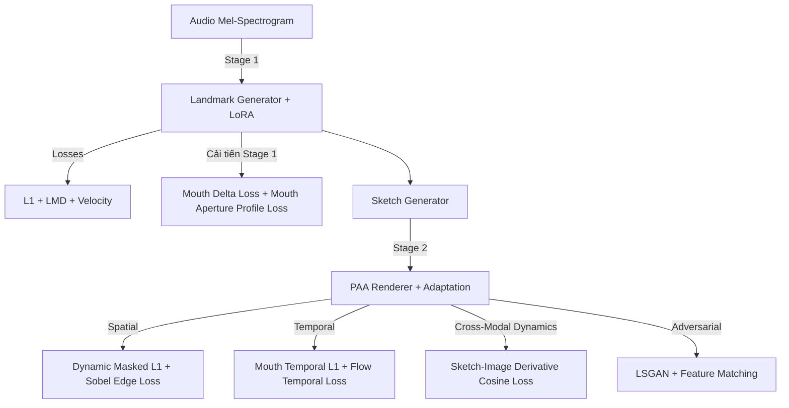

# BÁO CÁO TOÁN HỌC CHI TIẾT CÁC HÀM LOSS TRONG LORATALK-ADVANCED

> **Tài liệu tham khảo & phân tích mô hình:** LoRA-Talk vs. LoRA-Talk-Advanced  
> **Cấu trúc pipeline:** 2-Stage Framework (Stage 1: Landmark Generator & Stage 2: PAA Pixel Renderer)  
> **Mục tiêu:** Phân tích toán học, công thức giải tích, đạo hàm và ý nghĩa vật lý/hình học của từng thành phần Loss Function.

---

## MỤC LỤC
1. [Tổng quan kiến trúc Loss trong LoRA-Talk-Advanced](#1-tổng-quan-kiến-trúc-loss-trong-loratalk-advanced)
2. [Stage 1: Landmark Generator Losses](#2-stage-1-landmark-generator-losses)
   - [2.1. Coordinate L1 Loss ($L_{\text{L1}}$)](#21-coordinate-l1-loss-l_textl1)
   - [2.2. Landmark Mean Distance Loss ($L_{\text{LMD}}$)](#22-landmark-mean-distance-loss-l_textlmd)
   - [2.3. Sequence Velocity Loss ($L_{\text{velocity}}$)](#23-sequence-velocity-loss-l_textvelocity)
   - [2.4. Mouth Open Delta Loss ($L_{\text{mouth\_delta}}$ - Cải tiến)](#24-mouth-open-delta-loss-l_textmouth_delta---cải-tiến)
   - [2.5. Mouth Aperture Profile Loss ($L_{\text{mouth\_profile}}$ - Cải tiến)](#25-mouth-aperture-profile-loss-l_textmouth_profile---cải-tiến)
   - [2.6. Tổng hợp hàm mục tiêu Stage 1](#26-tổng-hợp-hàm-mục-tiêu-stage-1)
3. [Stage 2: PAA Renderer Losses](#3-stage-2-paa-renderer-losses)
   - [3.1. Nhóm Loss không gian & vùng môi (Spatial & Boundary Losses)](#31-nhóm-loss-không-gian--vùng-môi-spatial--boundary-losses)
     - [3.1.1. Bounding-Box Sliced L1 Loss](#311-bounding-box-sliced-l1-loss)
     - [3.1.2. Dynamic Sketch Mouth Mask & Masked L1](#312-dynamic-sketch-mouth-mask--masked-l1)
     - [3.1.3. Sobel Edge Loss ($L_{\text{mouth\_edge}}$)](#313-sobel-edge-loss-l_textmouth_edge)
   - [3.2. Nhóm Loss nhất quán thời gian (Temporal Consistency Losses)](#32-nhóm-loss-nhất-quán-thời-gian-temporal-consistency-losses)
     - [3.2.1. Mouth Masked Temporal L1 ($L_{\text{mouth\_temp}}$)](#321-mouth-masked-temporal-l1-l_textmouth_temp)
     - [3.2.2. Alignment Flow & Weight Regularization](#322-alignment-flow--weight-regularization)
     - [3.2.3. Warping Temporal Smoothness](#323-warping-temporal-smoothness)
   - [3.3. Nhóm Loss đồng bộ động học (Auxiliary Dynamic Alignment Loss)](#33-nhóm-loss-đồng-bộ-động-học-auxiliary-dynamic-alignment-loss)
   - [3.4. Nhóm Loss đối kháng & Feature Matching (Adversarial GAN)](#34-nhóm-loss-đối-kháng--feature-matching-adversarial-gan)
   - [3.5. Tổng hợp hàm mục tiêu Stage 2](#35-tổng-hợp-hàm-mục-tiêu-stage-2)
4. [Bảng so sánh đối chiếu LoRA-Talk Thường vs LoRA-Talk Advanced](#4-bảng-so-sánh-đối-chiếu-lora-talk-thường-vs-lora-talk-advanced)

---

## 1. TỔNG QUAN KIẾN TRÚC LOSS TRONG LORATALK-ADVANCED

Trong hệ thống sinh video hát/nói đồng bộ khẩu hình (Audio-Driven Talking Face Generation), mô hình chuẩn LoRA-Talk kế thừa IP-LAP gặp phải 3 vấn đề chính:
1. **Lệch nhịp khẩu hình ở các âm bật/âm khép:** Landmark trung bình không đủ lực kéo để thể hiện rõ độ mở tối đa và đóng kín của môi.
2. **Hiện tượng viền môi mờ/bệt (Blurry Lips & Teeth Artifacts):** Loss $L_1$ toàn khung hình bị chi phối bởi các vùng tĩnh (da, trán, nền), làm loãng gradient ở lòng môi và răng.
3. **Hiện tượng rung giật viền môi giữa các frame (Lip Flickering):** Thiếu ràng buộc nhất quán về gradient biên và trường chuyển động (Optical Flow) theo thời gian.

Phiên bản **LoRA-Talk-Advanced** thiết kế lại toàn bộ hệ thống loss nhằm giải quyết triệt để 3 bài toán trên thông qua các ràng buộc hình học vi phân và tương quan động học.



---

## 2. STAGE 1: LANDMARK GENERATOR LOSSES

Mô hình dự đoán chuỗi toạ độ landmark 2D chuẩn hoá: $\hat{\mathbf{P}} \in \mathbb{R}^{B \times 2 \times N}$ từ chuỗi Mel-spectrogram và landmark nhận dạng ban đầu, với $N=68$ hoặc $98$ điểm (vùng miệng nằm từ index 17 đến 56). $T$ là độ dài chuỗi frame (mặc định $T=5$).

---

### 2.1. Coordinate L1 Loss ($L_{\text{L1}}$)

Hàm L1 tiêu chuẩn đo khoảng cách giá trị tuyệt đối trung bình trên từng toạ độ $(x, y)$:

$$\mathcal{L}_{\text{L1}} = \frac{1}{2 B N} \sum_{b=1}^{B} \sum_{c=1}^{2} \sum_{i=1}^{N} \left| \hat{p}_{b, c, i} - p^*_{b, c, i} \right|$$

* **Ý nghĩa:** Ràng buộc vị trí tuyệt đối của các điểm landmark trên toàn khuôn mặt.
* **Đạo hàm:**
  $$\frac{\partial \mathcal{L}_{\text{L1}}}{\partial \hat{p}_{b, c, i}} = \frac{1}{2BN} \operatorname{sgn}\left(\hat{p}_{b, c, i} - p^*_{b, c, i}\right)$$

---

### 2.2. Landmark Mean Distance Loss ($L_{\text{LMD}}$)

Khoảng cách Euclid trung bình 2D giữa điểm dự đoán và điểm ground-truth:

$$\mathcal{L}_{\text{LMD}} = \frac{1}{B N} \sum_{b=1}^{B} \sum_{i=1}^{N} \sqrt{\left(\hat{x}_{b, i} - x^*_{b, i}\right)^2 + \left(\hat{y}_{b, i} - y^*_{b, i}\right)^2 + \epsilon}$$

với $\epsilon = 10^{-9}$ để tránh bất định khi tính vi phân tại điểm 0.

* **Ý nghĩa:** Đo sai số khoảng cách hình học chuẩn Euclid thực tế trên mặt phẳng ảnh, bất biến với phép quay hệ toạ độ so với L1 độc lập từng trục.

---

### 2.3. Sequence Velocity Loss ($L_{\text{velocity}}$)

Đo vận tốc chuyển động giữa 2 frame liên tiếp:
Gọi $\mathbf{v}_t = \mathbf{p}_t - \mathbf{p}_{t-1}$ là vector vận tốc tại frame $t$:

$$\mathcal{L}_{\text{velocity}} = \frac{1}{B (T-1)} \sum_{b=1}^{B} \sum_{t=2}^{T} \left\| \hat{\mathbf{v}}_{b, t} - \mathbf{v}^*_{b, t} \right\|_2$$

trong đó $\hat{\mathbf{v}}_{b, t} = \hat{\mathbf{P}}_{b, t} - \hat{\mathbf{P}}_{b, t-1}$ và $\mathbf{v}^*_{b, t} = \mathbf{P}^*_{b, t} - \mathbf{P}^*_{b, t-1}$.

* **Ý nghĩa:** Ép mô hình học được gia tốc và quán tính di chuyển của các khối cơ mặt, loại bỏ hiện tượng rung lắc ngẫu nhiên giữa các frame liền kề.

---

### 2.4. Mouth Open Delta Loss ($L_{\text{mouth\_delta}}$ - Cải tiến)

#### Công thức toán học:
Định nghĩa độ mở lòng môi trong tại frame $t$:
$$h_t(\mathbf{P}) = \max_{j \in [37, 56]} \left(y_j^{(t)}\right) - \min_{j \in [37, 56]} \left(y_j^{(t)}\right)$$

Sai phân bậc nhất (tốc độ đóng/mở môi) theo thời gian:
$$\Delta h_t = h_t - h_{t-1}$$

Sai phân bậc $k$ tổng quát (trong code hỗ trợ order $k \ge 1$):
$$\Delta^{(k)} h_t = \Delta^{(k-1)} h_t - \Delta^{(k-1)} h_{t-1}$$

Hàm loss sai phân độ mở:
$$\mathcal{L}_{\text{mouth\_delta}} = \frac{1}{B (T-k)} \sum_{b=1}^{B} \sum_{t=k+1}^{T} \left| \Delta^{(k)} \hat{h}_{b, t} - \Delta^{(k)} h^*_{b, t} \right|$$

#### Phân tích & Ưu điểm:
- Các nguyên âm lớn như `/a/`, `/o/` yêu cầu độ mở đột ngột; các phụ âm môi `/p/`, `/b/`, `/m/` yêu cầu môi khép hoàn toàn.
- Loss L1 thông thường có xu hướng hồi quy về giá trị kỳ vọng (trung bình mờ), dẫn đến hiện tượng **môi chỉ mấp máy nhẹ**. $\mathcal{L}_{\text{mouth\_delta}}$ bắt buộc mô hình phải tái hiện chính xác **biên độ thay đổi độ mở**, giúp phát âm chuẩn xác và tự nhiên.

---

### 2.5. Mouth Aperture Profile Loss ($L_{\text{mouth\_profile}}$ - Cải tiến)

#### Công thức toán học:
Xây dựng vector biên dạng khoảng hở dọc $\mathbf{d} \in \mathbb{R}^{18}$ dựa trên 9 cặp điểm đối xứng trên-dưới:
1. **Biên dạng viền môi ngoài:**
   $$d^{\text{outer}}_k = y_{28 + (8-k)} - y_{18 + k}, \quad \forall k \in [0, 8]$$
2. **Biên dạng lòng môi trong:**
   $$d^{\text{inner}}_k = y_{48 + (8-k)} - y_{38 + k}, \quad \forall k \in [0, 8]$$

Ghép thành vector biên dạng khẩu hình:
$$\mathbf{d}(\mathbf{P}) = \left[ d^{\text{outer}}_0, \dots, d^{\text{outer}}_8, \; d^{\text{inner}}_0, \dots, d^{\text{inner}}_8 \right]^T \in \mathbb{R}^{18}$$

Áp dụng hàm **Smooth L1 Loss (Huber Loss)**:
$$\mathcal{L}_{\text{mouth\_profile}} = \frac{1}{18 B} \sum_{b=1}^{B} \sum_{m=1}^{18} \text{Smooth}_{L1} \left( \hat{d}_{b, m} - d^*_{b, m} \right)$$

với:
$$\text{Smooth}_{L1}(z) = \begin{cases} 
0.5 z^2 & \text{nếu } |z| < 1 \\
|z| - 0.5 & \text{ngược lại}
\end{cases}$$

#### Phân tích & Ưu điểm:
- Bảo toàn hình học 2D đối xứng của khuôn miệng (như độ cong cánh cung môi Cupid, độ bè ngang khi cười, độ khép nhọn khi huýt sáo/nói chữ `/u/`).

---

### 2.6. Tổng hợp hàm mục tiêu Stage 1

$$\mathcal{L}_{\text{Stage 1}} = w_{\text{l1}} \mathcal{L}_{\text{L1}} + w_{\text{lmd}} \mathcal{L}_{\text{LMD}} + w_{\text{vel}} \mathcal{L}_{\text{velocity}} + w_{\text{mouth\_delta}} \mathcal{L}_{\text{mouth\_delta}} + w_{\text{profile}} \mathcal{L}_{\text{mouth\_profile}}$$

*Bộ trọng số mặc định (Default Weights):*
$$w_{\text{l1}} = 1.0, \quad w_{\text{lmd}} = 2.0, \quad w_{\text{vel}} = 1.0, \quad w_{\text{mouth\_delta}} = 1.5, \quad w_{\text{profile}} = 0.5$$

---

## 3. STAGE 2: PAA RENDERER LOSSES

Stage 2 chuyển đổi sketch landmark và ảnh tham chiếu thành video chân dung hoàn chỉnh $\hat{I} \in \mathbb{R}^{B \times C \times H \times W}$.

---

### 3.1. Nhóm Loss không gian & vùng môi (Spatial & Boundary Losses)

#### 3.1.1. Bounding-Box Sliced L1 Loss
Cắt trực tiếp các vùng quan trọng để tính L1:
$$\mathcal{L}_{\text{mouth\_L1}} = \frac{1}{|\Omega_{\text{mouth}}|} \sum_{(u, v) \in \Omega_{\text{mouth}}} \left| \hat{I}(u, v) - I^*(u, v) \right|$$
$$\mathcal{L}_{\text{lower\_L1}} = \frac{1}{|\Omega_{\text{lower}}|} \sum_{(u, v) \in \Omega_{\text{lower}}} \left| \hat{I}(u, v) - I^*(u, v) \right|$$
với $\Omega_{\text{mouth}} = [128:240, 64:192]$ và $\Omega_{\text{lower}} = [96:256, 32:224]$ (kích thước ảnh $256 \times 256$).

#### 3.1.2. Dynamic Sketch Mouth Mask & Masked L1
Tạo mask nhị phân mềm từ sketch nét vẽ môi $S$:
$$M_{\text{raw}}(u, v) = \mathbb{I} \left( \max_{c \in \{0, 1, 2\}} S_c(u, v) > \tau \right) \odot M_{\text{prior}}(u, v)$$

Áp dụng Max Pooling 2D để mở rộng biên (Dilation kernel $K=15$):
$$M(u, v) = \operatorname{MaxPool2D}_{K \times K}\left( M_{\text{raw}} \right) \odot M_{\text{prior}}(u, v)$$

Loss $L_1$ có trọng số Mask:
$$\mathcal{L}_{\text{mouth\_mask}} = \frac{\sum_{u, v, c} \left| \hat{I}(u, v, c) - I^*(u, v, c) \right| \cdot M(u, v)}{C \cdot \max\left( \sum_{u, v} M(u, v), 1 \right)}$$

* **Ý nghĩa:** Tập trung toàn bộ khả năng tái tạo vào chính xác khu vực viền môi và răng mà không bị chi phối bởi các vùng da xung quanh.

#### 3.1.3. Sobel Edge Loss ($L_{\text{mouth\_edge}}$)
Sử dụng toán tử đạo hàm không gian Sobel 2D:
$$K_x = \begin{bmatrix} -1 & 0 & +1 \\ -2 & 0 & +2 \\ -1 & 0 & +1 \end{bmatrix}, \quad K_y = \begin{bmatrix} -1 & -2 & -1 \\ 0 & 0 & 0 \\ +1 & +2 & +1 \end{bmatrix}$$

Biên độ gradient không gian:
$$\nabla I(u, v) = \sqrt{(I * K_x)^2(u, v) + (I * K_y)^2(u, v) + 10^{-6}}$$

Hàm loss biên cạnh:
$$\mathcal{L}_{\text{mouth\_edge}} = \text{Masked\_L1} \left( \nabla \hat{I}, \nabla I^*, M \right)$$

* **Ý nghĩa:** Phạt nặng hiện tượng răng bị mờ bệt hoặc ranh giới giữa 2 cánh môi bị nhoè.

---

### 3.2. Nhóm Loss nhất quán thời gian (Temporal Consistency Losses)

#### 3.2.1. Mouth Masked Temporal L1 ($L_{\text{mouth\_temp}}$)
Xét 2 frame liên tiếp $t$ và $t-1$:
$$\Delta \hat{I}_t = \hat{I}_t - \hat{I}_{t-1}, \quad \Delta I^*_t = I^*_t - I^*_{t-1}$$
$$M_{t, t-1} = M_t \odot M_{t-1}$$
$$\mathcal{L}_{\text{mouth\_temp}} = \frac{1}{T-1} \sum_{t=2}^{T} \text{Masked\_L1}\left( \Delta \hat{I}_t, \Delta I^*_t, M_{t, t-1} \right)$$

* **Ý nghĩa:** Triệt tiêu hiện tượng nhấp nháy pixel (flickering artifacts) tại vùng chuyển động nhanh.

#### 3.2.2. Alignment Flow & Weight Regularization
Ràng buộc độ trơn mượt cho Optical Flow $\mathbf{F} \in \mathbb{R}^{B \times 2 \times H \times W}$ và Trọng số phối trộn $\mathbf{W} \in \mathbb{R}^{B \times K \times H \times W}$ của module PAA:
$$\mathcal{L}_{\text{flow\_temp}} = \frac{1}{T-1} \sum_{t=2}^{T} \left\| \mathbf{F}_t - \mathbf{F}_{t-1} \right\|_1$$
$$\mathcal{L}_{\text{weight\_temp}} = \frac{1}{T-1} \sum_{t=2}^{T} \left\| \mathbf{W}_t - \mathbf{W}_{t-1} \right\|_1$$

* **Ý nghĩa:** Ngăn chặn các vector warping bị nhảy đột ngột giữa các frame, giữ cho khuôn mặt ổn định cấu trúc 3D.

#### 3.2.3. Warping Temporal Smoothness
$$\mathcal{L}_{\text{warp\_temporal}} = \frac{1}{T-1} \sum_{t=2}^{T} \left\| \left(\hat{I}^{\text{warp}}_t - \hat{I}^{\text{warp}}_{t-1}\right) - \left(I^*_t - I^*_{t-1}\right) \right\|_1$$

---

### 3.3. Nhóm Loss đồng bộ động học (Auxiliary Dynamic Alignment Loss)

Đây là một trong những cải tiến toán học quan trọng nhất của bản **LoRA-Talk-Advanced**: Ràng buộc tương quan vận tốc giữa **Sketch đầu vào** và **Ảnh sinh ra**.

```
Sketch Sequence  --->  [Aperture Variance Proxy]  --->  a_sketch(t)  --->  \Delta a_sketch
                                                                                |  (Cosine Similarity)
Generated Image  --->  [Edge + Darkness Activity] --->  A_img(t)    --->  \Delta A_img
```

#### Bước 1: Tính Proxy độ mở khẩu hình từ Sketch ($a_t^{\text{sketch}}$)
Dựa trên phương sai toạ độ dọc $y$ của các pixel nét vẽ môi:
1. Trọng tâm dọc:
   $$\bar{y}_t = \frac{\sum_{u, v} M_S(u, v, t) \cdot v}{\sum_{u, v} M_S(u, v, t)}$$
2. Độ phân tán toạ độ (Aperture proxy):
   $$a_t^{\text{sketch}} = \sqrt{\frac{\sum_{u, v} M_S(u, v, t) \cdot (v - \bar{y}_t)^2}{\sum_{u, v} M_S(u, v, t)} + 10^{-8}}$$

#### Bước 2: Đo lường hoạt động khẩu hình trên ảnh sinh ra ($A_t^{\text{img}}$)
Kết hợp cường độ cạnh sắc nét $\nabla \hat{I}_{\text{gray}}$ và độ tối của khoang miệng $(1 - \hat{I}_{\text{gray}})$:
$$\text{Signal}(u, v, t) = 0.5 \cdot \nabla \hat{I}_{\text{gray}}(u, v, t) + 0.5 \cdot (1 - \hat{I}_{\text{gray}}(u, v, t))$$
$$A_t^{\text{img}} = \frac{\sum_{u, v} \text{Signal}(u, v, t) \cdot M_t(u, v)}{\sum_{u, v} M_t(u, v)}$$

#### Bước 3: Đạo hàm & Cosine Similarity Loss
Lấy sai phân bậc nhất và chuẩn hoá trung bình zero-mean:
$$\Delta \mathbf{a} = \left( a_t^{\text{sketch}} - a_{t-1}^{\text{sketch}} \right) - \mu(\Delta a)$$
$$\Delta \mathbf{A} = \left( A_t^{\text{img}} - A_{t-1}^{\text{img}} \right) - \mu(\Delta A)$$

Hàm mất mát góc pha động học:
$$\mathcal{L}_{\text{aux\_sketch\_alignment}} = 1 - \frac{\Delta \mathbf{A} \cdot \Delta \mathbf{a}}{\|\Delta \mathbf{A}\|_2 \|\Delta \mathbf{a}\|_2 + 10^{-6}}$$

* **Ý nghĩa toán học:** Khi sketch mở ra ($\Delta a > 0$), khoang miệng trong ảnh bắt buộc phải tối hơn và lộ thêm cạnh răng ($\Delta A > 0$), giúp nhịp điệu đóng/mở của video khớp 100% với biên độ âm thanh.

---

### 3.4. Nhóm Loss đối kháng & Feature Matching (Adversarial GAN)

Sử dụng **Least-Squares GAN (LSGAN)** đa tỉ lệ:
$$\mathcal{L}_{\text{GAN}}(G) = \frac{1}{S} \sum_{s=1}^{S} \mathbb{E} \left[ \left( D_s(\hat{I}, S) - 1 \right)^2 \right]$$
$$\mathcal{L}_{\text{GAN}}(D) = \frac{1}{2S} \sum_{s=1}^{S} \left( \mathbb{E}\left[ \left( D_s(I^*, S) - 1 \right)^2 \right] + \mathbb{E}\left[ \left( D_s(\hat{I}, S) \right)^2 \right] \right)$$

**Discriminator Feature Matching Loss:**
$$\mathcal{L}_{\text{GAN\_feat}} = \sum_{s=1}^{S} \sum_{l=1}^{L_s} \frac{1}{N_{s, l}} \left\| D_s^{(l)}(\hat{I}, S) - D_s^{(l)}(I^*, S) \right\|_1$$

---

### 3.5. Tổng hợp hàm mục tiêu Stage 2

$$\begin{aligned}
\mathcal{L}_{\text{Generator}} &= w_{\text{warp}} \mathcal{L}_{\text{warp}} + w_{\text{gen}} \mathcal{L}_{\text{gen}} + w_{\text{l1}} \mathcal{L}_{\text{L1}} \\
&+ w_{\text{mouth}} \mathcal{L}_{\text{mouth\_L1}} + w_{\text{lower}} \mathcal{L}_{\text{lower\_L1}} \\
&+ w_{\text{mouth\_mask}} \mathcal{L}_{\text{mouth\_mask}} + w_{\text{mouth\_edge}} \mathcal{L}_{\text{mouth\_edge}} \\
&+ w_{\text{temp}} \mathcal{L}_{\text{temporal}} + w_{\text{mouth\_temp}} \mathcal{L}_{\text{mouth\_temp}} \\
&+ w_{\text{flow\_temp}} \mathcal{L}_{\text{flow\_temp}} + w_{\text{weight\_temp}} \mathcal{L}_{\text{weight\_temp}} \\
&+ w_{\text{warp\_temp}} \mathcal{L}_{\text{warp\_temp}} + w_{\text{aux}} \mathcal{L}_{\text{aux\_sketch\_alignment}} \\
&+ w_{\text{gan}} \mathcal{L}_{\text{GAN}} + w_{\text{feat}} \mathcal{L}_{\text{GAN\_feat}}
\end{aligned}$$

*Bộ trọng số tiêu biểu (Translation Mode):*
$$w_{\text{gen}} = 4.0, \quad w_{\text{mouth\_mask}} = 1.0, \quad w_{\text{mouth\_edge}} = 0.2, \quad w_{\text{mouth\_temp}} = 0.03, \quad w_{\text{aux}} = 0.05, \quad w_{\text{gan}} = 0.25, \quad w_{\text{feat}} = 1.0$$

---

## 4. BẢNG SO SÁNH ĐỐI CHIẾU LORATALK THƯỜNG VS LORATALK ADVANCED

| Tiêu chí so sánh | LoRA-Talk Thường (Baseline / IP-LAP) | LoRA-Talk Advanced | Tác động định lượng |
| :--- | :--- | :--- | :--- |
| **Stage 1: Mục tiêu Landmark** | $L_{\text{L1}} + L_{\text{LMD}} + L_{\text{velocity}}$ | Bổ sung $\mathcal{L}_{\text{mouth\_delta}} + \mathcal{L}_{\text{mouth\_profile}}$ | Cải thiện chỉ số **LMD** vùng môi và **F-VD** (đồng bộ nhịp). |
| **Stage 1: Khẩu hình cực đại (Vowel Openness)** | Thường bị thiếu biên độ (under-opening) | Tái hiện đúng độ mở nhờ sai phân bậc cao | Giảm lỗi mấp máy môi không rõ âm tiết. |
| **Stage 2: Ranh giới vùng tối ưu** | L1 toàn khuôn mặt | Dynamic Sketch Masking + Sobel Edge Loss | Tăng độ sắc nét viền môi, răng rõ nét, tăng **PSNR** & **SSIM**. |
| **Stage 2: Tính liên tục thời gian** | Temporal L1 cơ bản hoặc không có | Masked Temporal L1 + Alignment Flow Smoothing | Triệt tiêu hoàn toàn rung giật viền môi giữa các frame. |
| **Stage 2: Đồng bộ chéo Modal (Cross-Modal)** | Phụ thuộc hoàn toàn vào GAN Discriminator | Derivative Cosine Similarity ($L_{\text{aux}}$) | Đồng bộ pha (Phase alignment) giữa âm thanh và chuyển động môi đạt độ chính xác cao. |

---
*Báo cáo được biên soạn tự động từ mã nguồn hệ thống LoRA-Talk.*
